# StoreFront-Android

A native Android shopping app built with **Kotlin**, **Jetpack Compose** and **Firebase**
Shoppers browse a catalogue, fill a cart and check out; staff manage stock and accounts from a built-in back office


## Features

| Area | What you can do |
| --- | --- |
| **Catalogue** | Search by name, category or brand; filter from the side drawer; swipeable photo gallery; discount and low-stock badges |
| **Cart** | Add, change quantity (capped at available stock), remove, clear; live total and item-count badge |
| **Checkout** | Delivery address and payment method; stock is reserved and the order saved in one atomic transaction |
| **Orders** | Order history with status chips and a detail view showing the prices paid |
| **Account** | Email/password sign-up and sign-in, session restored on relaunch, editable profile |
| **Back office** | Admins list customers, change roles, restock products or zero them out |

## Screens

### Shopping

| Catalogue | Product details | Cart | Checkout |
| :---: | :---: | :---: | :---: |
| 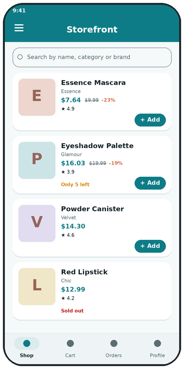 | 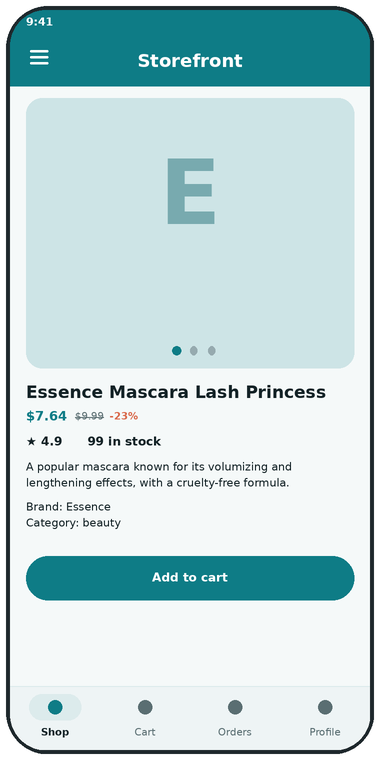 | 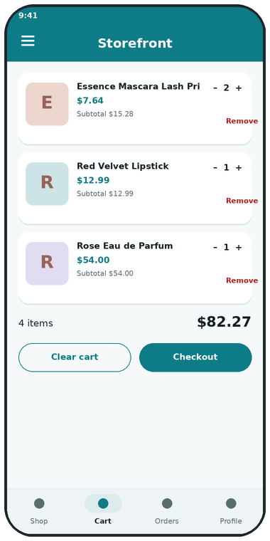 | 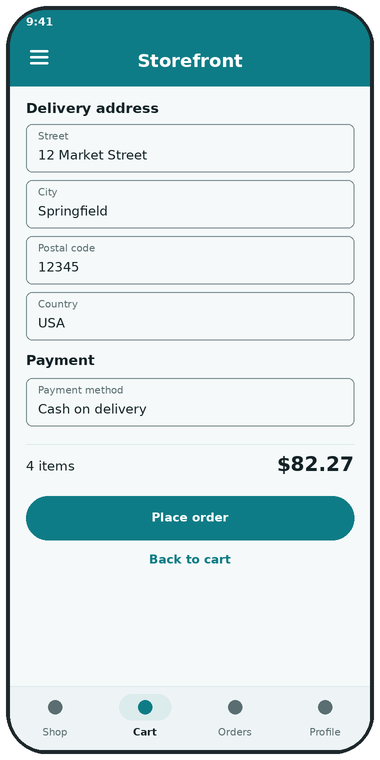 |

### Account and orders

| Sign in | Sign up | Orders | Order details | Profile |
| :---: | :---: | :---: | :---: | :---: |
| 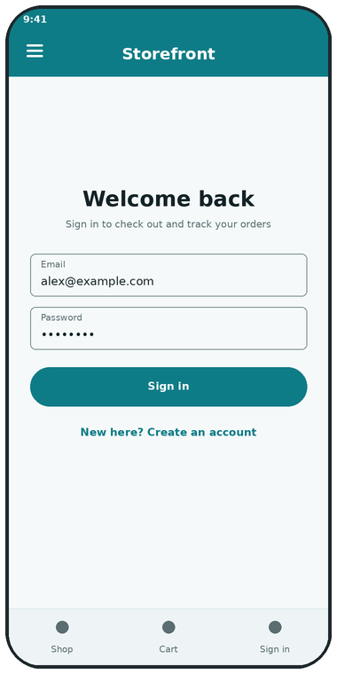 | 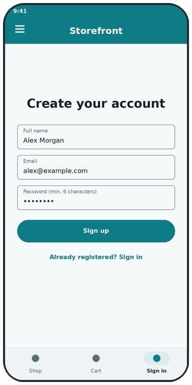 | 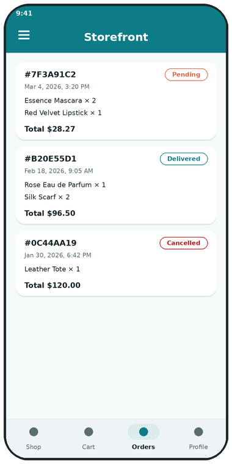 | 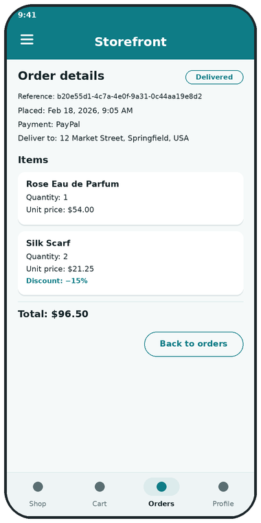 | 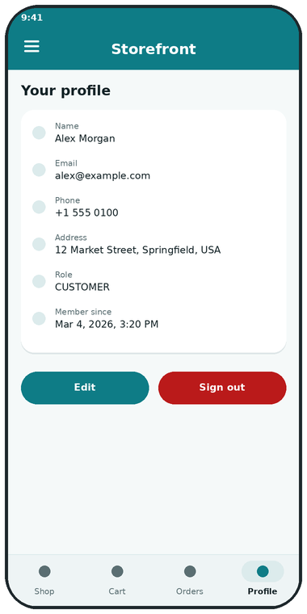 |

### Back office (admins only)

| Admin hub | Inventory | Customers |
| :---: | :---: | :---: |
| 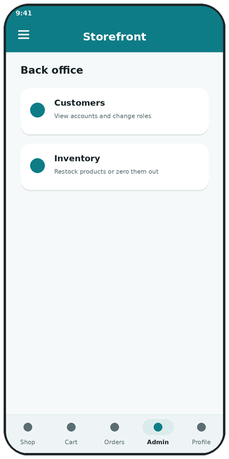 | 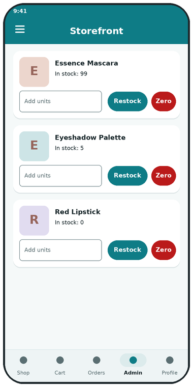 | 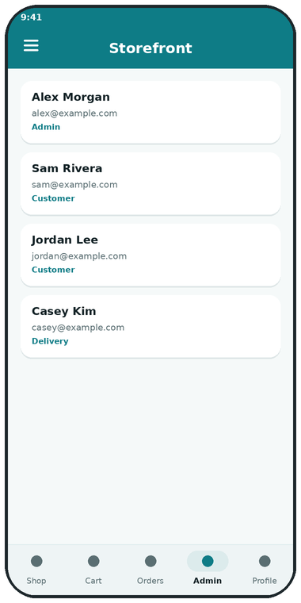 |

## Architecture

The app follows a unidirectional **MVI-style** flow. Each feature owns a *contract* (`UiState` + `Action`), a `ViewModel`
that reduces actions into new state, and stateless Compose screens that render it. Repositories are the only code that talks to Firebase.

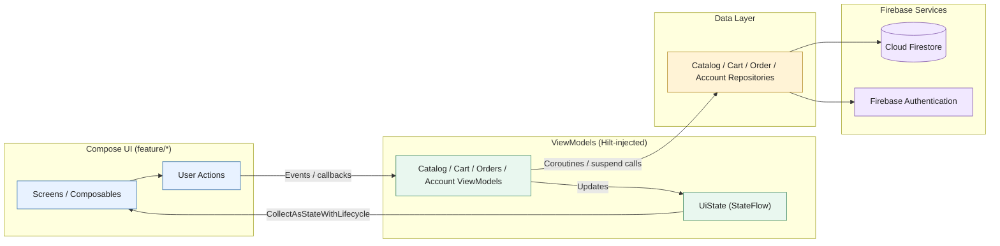

Dependencies point inward: `feature` → `data` → `domain`. The `domain` package is plain Kotlin (models, pricing rules,
order construction) so it is unit-testable on the JVM

### Navigation

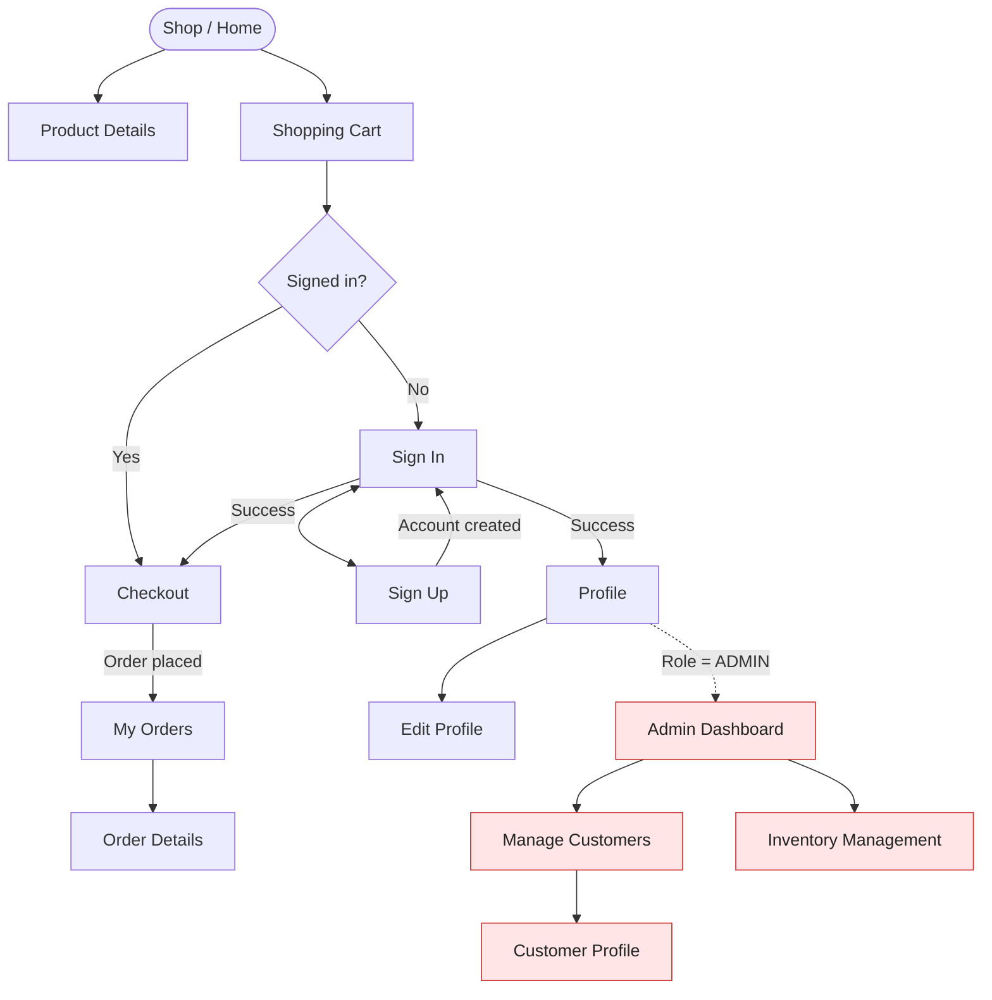

Routes that need a session (checkout, orders, profile) or the `ADMIN` role (back office) are wrapped in a guard that redirects to sign-in

## Data model

Firestore collections and their relationships:

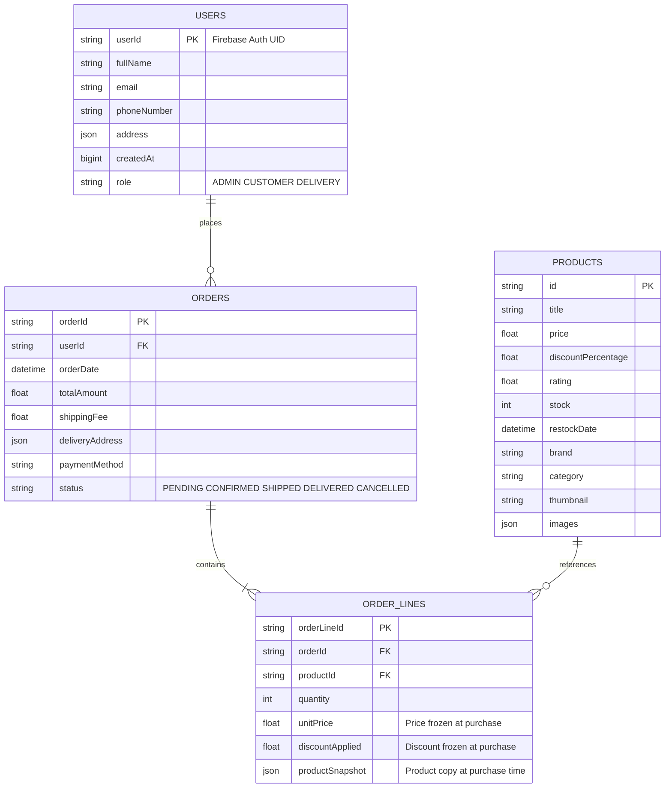

Order lines embed a copy of the product with the price and discount **as paid**, so later catalogue edits never rewrite history

## Key flows

### Checkout

Stock is checked and decremented inside a Firestore transaction together with the order write, so two shoppers can't buy the last unit

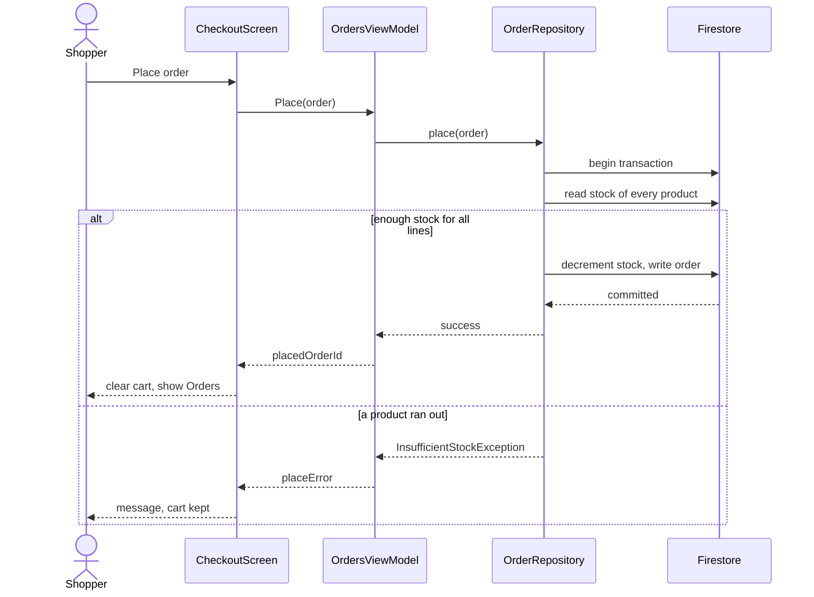

### Sign-in and session

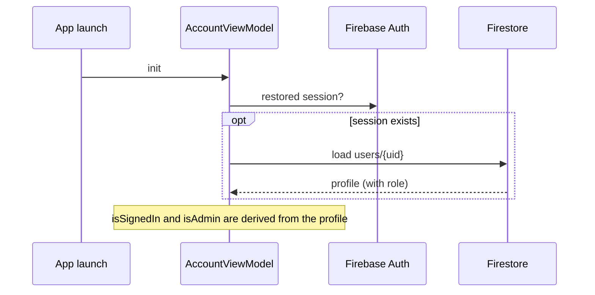

## Tech stack

| Concern | Choice |
| --- | --- |
| Language / UI | Kotlin 2.0, Jetpack Compose, Material 3 |
| Navigation | Navigation Compose with typed `Destination` objects |
| DI | Hilt (KSP) |
| Backend | Firebase Authentication and Cloud Firestore |
| Images | Coil |
| Async | Coroutines + `StateFlow` |
| Tests | JUnit 4 (pure-JVM unit tests) |

Dependency versions live in [`gradle/libs.versions.toml`](gradle/libs.versions.toml)

## Project structure

```
app/src/main/java/com/storefront/app/
├── StorefrontApplication.kt      Hilt entry point
├── MainActivity.kt               hosts the four activity-scoped ViewModels
├── core/
│   ├── firebase/                 Hilt module, Task.awaitResult()
│   ├── format/                   price, rating and date formatting
│   ├── theme/                    colours and Material 3 theme
│   ├── ui/                       shared composables (loading/empty/error, price tag, form fields…)
│   └── util/                     attempt{}, validation
├── domain/model/                 Product, CartLine, Order, User… plus pricing rules and OrderFactory
├── data/                         CatalogRepository, OrderRepository, AccountRepository
├── navigation/                   Destination, NavHost, scaffold (drawer, top and bottom bars)
└── feature/
    ├── catalog/                  list, details, gallery, inventory screen
    ├── cart/
    ├── orders/                   history, details, checkout
    ├── account/                  sign-in/up, profile, edit, customer directory
    └── admin/                    back-office hub

tools/seed/                       Node scripts: load demo products, grant roles
firestore.rules                   recommended security rules
docs/                             screenshots
```

## Getting started

**Requirements:** Android Studio (recent stable), JDK 17, a Firebase project

1. **Create a Firebase project** and enable **Authentication → Email/Password** and **Cloud Firestore**
2. **Register an Android app** in Firebase with the package name `com.storefront.app`
   (or change `applicationId` and `namespace` in `app/build.gradle.kts` to your own and register that instead)
3. **Download `google-services.json`** and place it in `app/`. It is git-ignored
4. **Deploy the rules** from [`firestore.rules`](firestore.rules) (Firebase console → Firestore → Rules)
5. **Load demo data** (optional but recommended):
   ```bash
   cd tools/seed
   npm install
   export GOOGLE_APPLICATION_CREDENTIALS=/absolute/path/to/service-account.json   # keep this file outside the repo
   npm run seed
   ```
6. **Run** the `app` configuration on an emulator or device (API 29+)
7. **Create your first admin:** sign up in the app, then
   ```bash
   npm run set-role -- you@example.com ADMIN
   ```
   Sign out and back in to see the Admin tab
